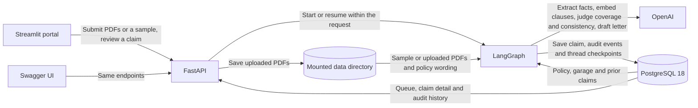
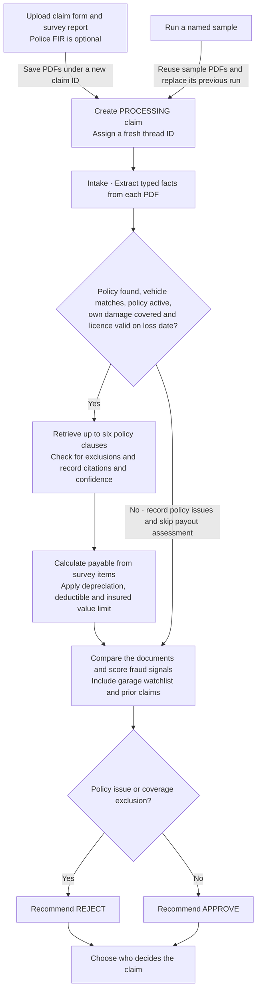
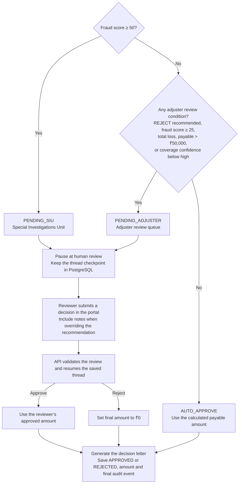

# ClaimSense system design

ClaimSense processes synthetic motor insurance claims for the fictional insurer NorthStar. For each submission, it checks coverage, calculates the amount supported by the survey and determines who may make the final decision. A small, covered claim can settle automatically. Every recommended rejection needs a person’s decision. [Course problem by Shivank Agrawal](../../Documents/scaler_notes/ai-bootcamp/day6/insurance-project3/problem.html)

## Follow one claim through the current system

### From submission to a recommendation

### From recommendation to final decision

**Trace it in the portal.** For sample `CLM-1008`, the recorded run had a fraud score of 0 and an assessed payout of ₹90,000. Follow **No** at the fraud threshold, then **Yes** at the adjuster check because ₹90,000 exceeds ₹50,000. The portal shows `PENDING_ADJUSTER` until a reviewer submits a decision. The restart test approves this claim on its saved thread and checks the ₹90,000 letter. [Recorded run](evals/scorecards/2026-11-23.csv) · [Portal test](tests/test_portal_restart.py)

1. **Submit.** Streamlit posts the claim form, survey report and optional police FIR to `POST /claims`. The API saves the PDFs under `data/uploads/<claim_id>/`, creates a `PROCESSING` claim and assigns a fresh LangGraph `thread_id`. The sample endpoint uses an existing directory and its sample ID. [API routes](src/claim_sense/api/claims.py) · [Claim service](src/claim_sense/services/service.py)
2. **Read and assess.** Each PDF gets a separate model call and typed output. Python checks policy existence, vehicle registration, cover dates, own-damage cover and licence validity. A hard failure skips coverage retrieval and payout assessment and goes directly to the fraud check. Otherwise the graph retrieves policy clauses, asks the model about exclusions, then calculates the amount from the survey items. [Intake](src/claim_sense/services/intake.py) · [Graph edges](src/claim_sense/workflows/graph.py)
3. **Route.** The model compares the accounts in the form, survey and FIR. Python combines contradictions with signals such as prior claims and garage watchlist status, records their points and chooses the route. The API returns HTTP 200 with the saved claim once it finishes or pauses. Initial graph exceptions are also recorded as a claim with `status=FAILED` and an `error` field. Inspect the returned status when debugging an upload. [Rules](src/claim_sense/domain/rules.py) · [Claim service](src/claim_sense/services/service.py)
4. **Review and finalize.** For a pending claim, the portal posts the review to `/claims/{claim_id}/review`. The service checks pending status, the approval amount against the available insured declared value (IDV), and notes for overrides. It resumes the saved thread. Python sets the final amount, using zero for rejection, and the model drafts the letter. The portal displays the saved letter and audit trail. Sending the letter to a customer would require a delivery integration. Reviewer names currently come from the submitted form. [Portal](ui/portal.py) · [Review schema](src/claim_sense/schemas/schemas.py)

For example, uploading the PDFs from `CLM-1014` creates a new `CLM-U…` ID. The integration test supplies a police finding of intoxication, retrieves `EXC-4`, and checks that the recommendation is `REJECT` while the status is still `PENDING_ADJUSTER`. After the adjuster rejects, the same claim reads `REJECTED` with a ₹0 final amount. Use the ID from the upload response for both the review and the final GET. [Executable example](tests/test_claim_review.py)

## How the decision is calculated

**Coverage.** The retriever splits the policy wording on clause headings, embeds the clauses, and ranks them by cosine similarity to the claim facts. Up to six clauses go to the model. The service removes any cited exclusion ID outside that set and lowers confidence on unsupported citations or an exclusion with no valid citation. This checks clause membership. A reviewer still needs to judge whether the facts support the exclusion. [Retrieval](src/claim_sense/services/policy_rag.py) · [Coverage judgment](src/claim_sense/services/judgments.py)

**Payout.** Python starts with the surveyor’s assessed line items. Each line retains the part category, amount, depreciation rate, deduction and net amount. Zero-depreciation cover waives part depreciation. The ordinary payout subtracts depreciation and the compulsory deductible, with a floor of zero and a cap at IDV. Gross repairs above 75% of IDV use the total-loss calculation of IDV less deductible. For the clean fixture `CLM-1001`, ₹20,700 − ₹7,650 − ₹1,000 gives ₹12,050. [Payout rules](src/claim_sense/domain/rules.py) · [Course worked example](../../Documents/scaler_notes/ai-bootcamp/day6/insurance-project3/solution.html)

**Routing.** Apply these rows top to bottom. A recommendation describes coverage. A route selects the decision maker, so a claim with an approval recommendation can still require investigation. [Thresholds](src/claim_sense/core/config.py) · [Routing order](src/claim_sense/domain/rules.py)

| First matching condition | Route | Result |
| --- | --- | --- |
| Fraud score ≥ 50 | SIU_INVESTIGATION | Pause at PENDING_SIU |
| Recommended rejection, score ≥ 25, total loss, payable > ₹50,000, or coverage confidence below high | ADJUSTER_REVIEW | Pause at PENDING_ADJUSTER |
| Remaining eligible claims | AUTO_APPROVE | Generate letter and set APPROVED |

## What survives a restart

| Store | Contents and reader |
| --- | --- |
| Mounted `data/` | The API writes uploads here. The graph reads PDFs and policy wording and caches clause embeddings in `policy_index.json`. Sample directories and eval labels are local inputs. |
| PostgreSQL application tables | `policies`, `garages` and `prior_claims` supply reference facts. `claims` holds the current status, thread ID, assessment, recommendation, final amount and letter. `audit_log` records the actor, time, step and result. Claim detail and queue endpoints read these tables. |
| PostgreSQL LangGraph tables | Checkpoints hold the execution state for a thread. A review uses its stored ID and `Command(resume=...)`. The Compose volume keeps both application records and checkpoints across API restarts. |

Startup creates tables. Loading reference rows is a separate operation. Rerunning a named sample clears its previous claim row and audit entries and allocates a new thread. For repeatable comparisons, use a dedicated demo database. Application writes, audit events and checkpoints currently commit separately. A persisted review pause supports later resumption, while recovery from a crash between writes still needs the worker changes below. [Persistence](src/claim_sense/db/repository.py) · [Application startup](src/claim_sense/main.py) · [Compose](docker-compose.yml)

## Verification and remaining course work

The portal shows survey deductions with their policy clauses, coverage wording, fraud signals, and a manager dashboard. Claim snapshots retain the retrieved wording as it appeared at decision time. The restart test submits a pending claim, replaces the API process, then approves the saved thread through Streamlit. The 20-claim scorecard records a missed vehicle-use exclusion on CLM-1015. The remaining course milestone is the AWS demo with teardown. [Portal tests](tests/test_portal_restart.py) · [Scorecard](evals/scorecards/2026-11-23.md) · [Roadmap](roadmap.md)

The evaluator records initial routing and assessment before review. With `--resume`, it also times the simulated review and letter generation. Each final claim records total model cost and active processing time across both phases. The evaluator requires configured prices for the selected models, applies cached-input pricing to the reported cached tokens, and builds the shared policy index before starting the claim timer. [Evaluator](evals/run_evals.py) · [Cost calculation](src/claim_sense/integrations/llm.py)

## Proposed worker and recovery

Implement this extension once the synchronous baseline is reproducible. A queue shortens the upload request and gives another process a way to recover interrupted work. Keep the existing graph and public claim ID.

| Boundary | Proposed behavior |
| --- | --- |
| Accept upload | Stage immutable PDFs by document type. In one PostgreSQL transaction, store the claim, run with a unique thread ID, and PROCESS job. Return HTTP 202 with the claim ID and status for polling. A scoped submission key plus content digest identifies identical retries. Return the original claim on a match and HTTP 409 for different content. Clean up unreferenced staged files. |
| Execute or recover | A worker sharing the PDFs leases a job, records an attempt, renews the lease and runs the graph. After expiry a replacement resumes the same checkpoint. Fence business writes and checkpoint writes by checking current lease ownership in their respective write transactions. Bound retries and record a terminal failure reason. |
| Publish review | Expose a pending queue status after the interrupt checkpoint is durable. If a worker stops between those writes, a replacement can publish the saved pause. Authorize the reviewer for the queue and commit one accepted review and its RESUME job together. Identical review replays return the saved result and conflicting decisions fail. |
| Finalize | Commit one final decision per run, its letter, the final audit event and job completion together. A retry may repeat a model call. Enforce uniqueness on the committed outcome and preserve attempts and earlier runs. |

Introduce these records with versioned migrations. Move uploads and sample submissions onto the worker, update the portal to poll `GET /claims/{claim_id}`, and keep the CLI and evaluator able to wait for a resolved route. For page-level evidence, start by storing a document ID, page and verified quote for one survey amount. The planned AWS deployment uses ECS, persistent PostgreSQL and private PDF storage. The sibling repository owns the infrastructure. [Terraform](../Claim-Sense-Terraform/main.tf)
