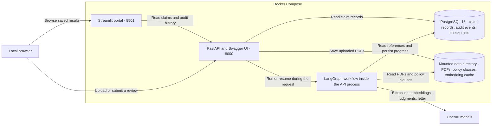
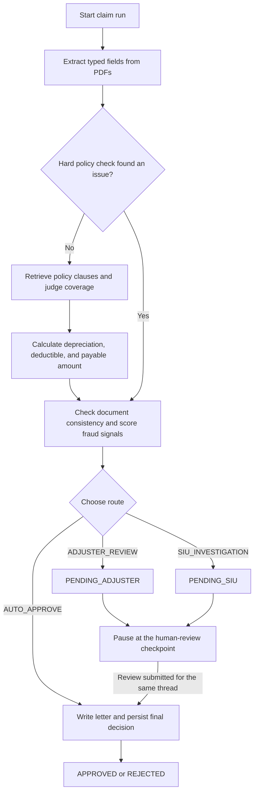
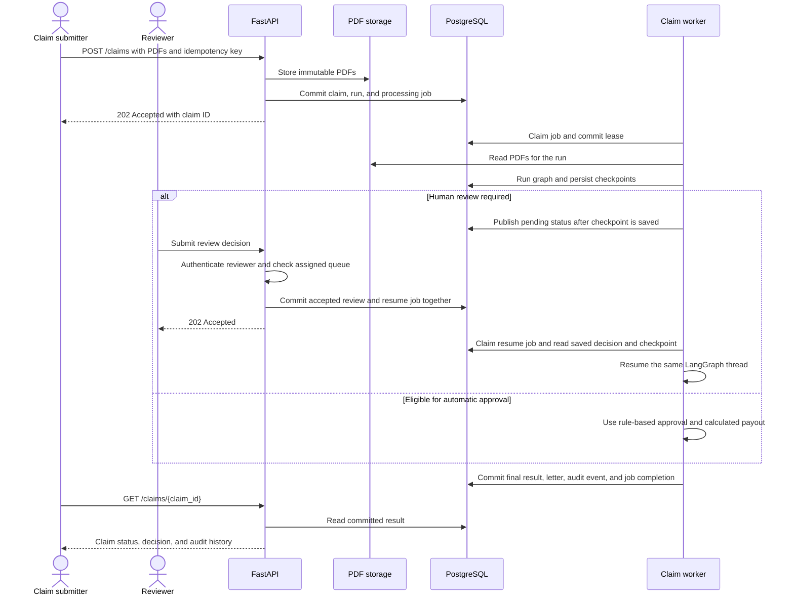
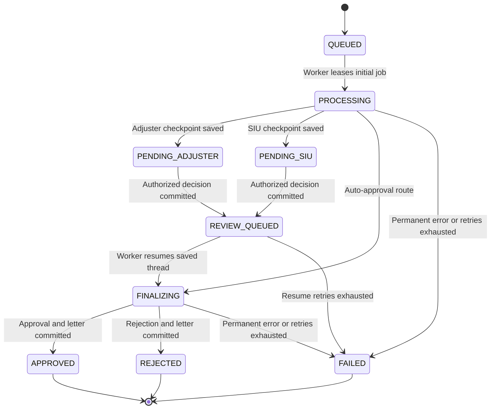
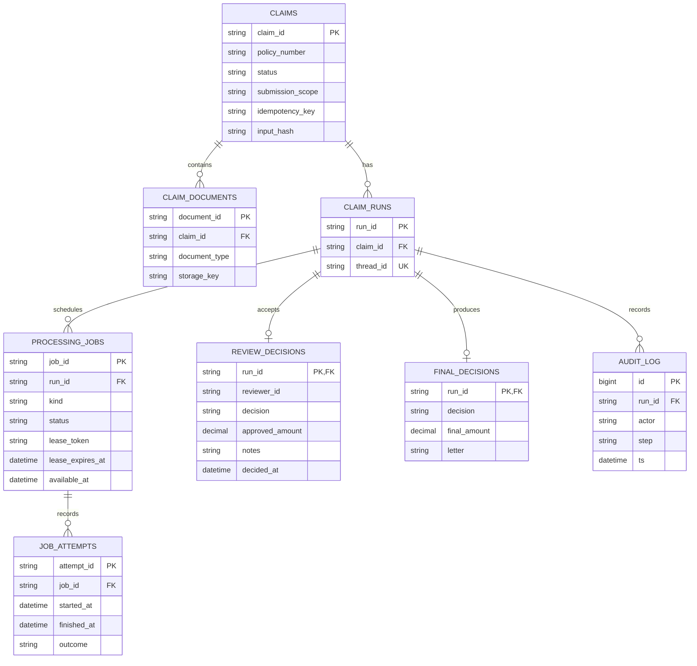

# ClaimSense System Design

ClaimSense processes synthetic motor insurance claims from a claim form, a surveyor report, and an optional police report. It checks policy coverage, calculates a payable amount, and routes claims to automatic approval, an adjuster, or the Special Investigation Unit (SIU). The design builds on Shivank Agrawal's ClaimSense course.

The local baseline runs on FastAPI, PostgreSQL 18, LangGraph, and Streamlit. A smoke test with mocked model responses verified that a pending claim could survive container replacement and resume from PostgreSQL. The roadmap's next milestone is a repeatable `CLM-1014` upload and review test.

## Current runtime

The portal is read-only. The API persists claim snapshots for browser reads. LangGraph persists execution state under the stored `thread_id` so a later review request can resume the same run. Sample reprocessing currently replaces the prior claim and its audit history. [Local setup](README.md) · [API routes](src/claim_sense/api/claims.py) · [Claim service](src/claim_sense/services/service.py)

## Claim workflow

Python controls eligibility checks, payout arithmetic, fraud scoring, and routing thresholds. Policy retrieval ranks embedded clauses by similarity. The model extracts fields, judges coverage using those clauses, flags document inconsistencies, and drafts a letter from the selected decision and amount. With the current defaults, a fraud score of 50 or more routes to SIU. Otherwise, a rejection recommendation, score of 25 or more, total loss, payable amount above ₹50,000, or lower-confidence coverage routes to an adjuster. A human makes the final decision on any recommended rejection. [Workflow](src/claim_sense/workflows/graph.py) · [Policy retrieval](src/claim_sense/services/policy_rag.py) · [Business rules](src/claim_sense/domain/rules.py)

## Planned worker and review flow

The API will acknowledge uploads after committing a claim and a processing job. A separate worker will run the graph and use the existing PostgreSQL checkpoints. PostgreSQL also holds the accepted review and the job that resumes it.

### Uploads, leases, and recovery

- **Upload idempotency.** Scope an idempotency key to the submitter and associate it with a hash of the PDF contents by document type. Reusing the key with the same contents returns the original claim ID. Different contents return `409 Conflict`. Keep staged PDFs at distinct storage keys and clean up unreferenced uploads after failed or duplicate submissions.
- **Job leasing.** Select an eligible job using `FOR UPDATE SKIP LOCKED`. Commit a lease token, expiry, and attempt record before starting work. Renew the lease during longer operations, let replacement workers reclaim expired leases, and use bounded backoff for transient failures.
- **Safe recovery.** Extend checkpoint persistence to verify the lease token and expiry in the same transaction as each checkpoint write. Apply the same check to business writes. A replacement worker resumes from the last committed checkpoint with the same `thread_id`. If a crash occurs between saving the review interrupt and publishing the pending status, the replacement can publish the already-saved pending state.
- **Finalization.** Use one final decision row per run. Commit the outcome, saved letter, final audit event, and job completion together. Retries can repeat external model calls. The database constraint and lease check keep the committed result unique.
- **Review authorization.** Derive reviewer identity from authentication and enforce access to the assigned queue. Store one accepted decision per run with actor, timestamp, amount, and notes. Require notes for overrides. Return the saved result for an identical replay and reject conflicting decisions.

### Planned status transitions

Keep retry scheduling in the job record. The claim stays in its current phase while an attempt can still recover.

## Planned persistence model

The baseline already has `claims`, `audit_log`, `policies`, `prior_claims`, and `garages`, plus the tables managed by LangGraph's PostgreSQL checkpointer. The target claim-processing records below are the basis for versioned migrations. The reference tables continue to supply policy, history, and garage data. [Current SQLAlchemy models](src/claim_sense/models/models.py)

Enforce unique `(submission_scope, idempotency_key)` and `(run_id, kind)` constraints for claim submissions and jobs. Job kinds are `PROCESS` and `RESUME`. Retrying a job appends an attempt to the same job. A deliberate rerun gets a new run and thread ID while preserving previous attempts, decisions, and audit events. Application tables remain the authority for API status and decisions.

## Planned evidence and deployment

- **PDF evidence.** Start with payout-critical survey line items. Store each extracted value with its document ID, page number, supporting quote, and verification result. Match the quote against text on the cited page and check that it supports the value. Missing or conflicting evidence goes to manual review. The reviewer sees the PDF evidence, retrieved policy clauses, and deterministic payout breakdown.
- **Local development.** Run the API, UI, worker, and PostgreSQL in Docker Compose. Make the PDF directory available to both the API and worker. Run integration tests with fake model responses and a disposable PostgreSQL database.
- **AWS demo.** The sibling `Claim-Sense-Terraform` repository will define the deployment. The planned topology uses ECS tasks for API, UI, and worker, RDS for PostgreSQL, and private S3 storage for PDFs. Use runtime secrets and task roles for resource access. Log claim IDs, workflow steps, attempts, latency, and model cost without including PDF contents.

## Verification scenarios

| Scenario | Expected result |
| --- | --- |
| `CLM-1014` baseline | With fake model responses, the claim reaches `PENDING_ADJUSTER` with a rejection recommendation. A human rejection yields `REJECTED`, zero payout, a letter, and review and finalization audit events. |
| `CLM-1001` and `CLM-1019` | Verify the ₹12,050 payout for the clean claim and SIU routing for the investigation case. |
| Duplicate and conflicting uploads | An identical replay returns the same claim ID. Changing the PDFs with the same key yields `409 Conflict`. |
| Worker lost during processing | A replacement reclaims the job, resumes the run, and leaves prior attempts visible. |
| Worker stops after a review is accepted | The review and resume job survive together. The replacement produces one final decision, letter, and finalization audit event. |
| Reviewer or citation failure | A reviewer outside the assigned queue is denied. A payout-critical value without verified evidence goes to manual review. |

Use the same cases to compare payout accuracy, routing accuracy, evidence verification, model cost, and end-to-end latency. Record per-case results and document how to reproduce them before the AWS recovery demo.
