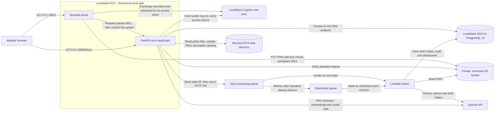
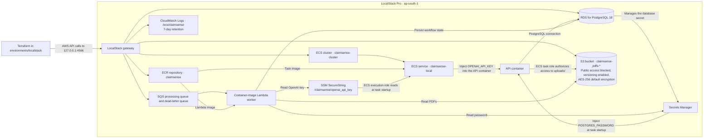
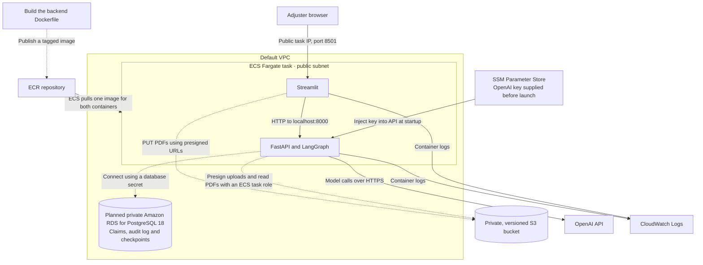

# Claim-Sense infrastructure

The LocalStack Pro configuration runs Claim-Sense in the `claimsense-local` ECS service and provisions a separate RDS for PostgreSQL 18 instance. Docker Compose provides a development environment with its own PostgreSQL 18 container and volume.

## 1. Where a LocalStack ECS claim goes

RDS stores claim records, audit events and LangGraph checkpoints. Streamlit uploads the PDFs using presigned PUT URLs and calls FastAPI to confirm them. With the worker deployed, the API verifies the objects at `uploads/<claim_id>/<document>.pdf`, records a `QUEUED` claim and sends only its ID through SQS. Lambda reads the PDFs, runs the original workflow and records the result in RDS. Human reviews and sample runs use FastAPI. Sample and older PDFs remain on the host mount under `~/.cache/claimsense-ecs/data`. [Claim processing and review flow](Design.md)

**Verified on LocalStack Pro on 26 November 2026.** All three PDFs for synthetic claim `CLM-UB8B99BB472F64ED0ACDC60FE9F9CCE96` matched the source files in private S3. A repeated PUT was rejected. FastAPI read the PDFs from S3, saved the claim as `PENDING_ADJUSTER`, and returned the same workflow thread on a repeated completion request.

**Lambda verified on LocalStack Pro on 28 November 2026.** Synthetic claim `CLM-U315744012C0D41689760365DB107AFD0` received HTTP 202 in 0.14 seconds after upload confirmation, then advanced through `QUEUED`, `PROCESSING` and `PENDING_ADJUSTER`. The ECS review API resumed the same thread and approved ₹90,000.

- Streamlit portal [http://127.0.0.1:18501/](http://127.0.0.1:18501/)
- FastAPI docs [http://127.0.0.1:18000/docs](http://127.0.0.1:18000/docs)

The LocalStack portal requires a Cognito account. An administrator can create one with `make local-user USERNAME=adjuster` from the Terraform repository. FastAPI verifies the access token before serving claim routes, and review records use the authenticated username. The health endpoint stays available for ECS probes. [LocalStack Terraform setup](https://github.com/MP-30/Claim-Sense-Terraform)

## 2. What Terraform provisions in LocalStack

Terraform provisions the foundation first. Publish the API and worker images before applying the local configuration to update ECS and deploy Lambda with its SQS mappings. Run `make local-check` in the Terraform repository to verify Lambda, the HTTP endpoints and the PostgreSQL version. [Terraform repository](https://github.com/MP-30/Claim-Sense-Terraform)

**Verified on 25 November 2026.** The ECS API connected to LocalStack RDS running PostgreSQL 18.7. The migration preserved the three existing claims and their audit and checkpoint records. A new synthetic claim, `CLM-U14C6F4`, kept its LangGraph thread and original PDFs across task replacement and was then approved for ₹90,000.

### OpenAI configuration and claim retries

Store the OpenAI key in LocalStack Parameter Store as a `SecureString`. The local Terraform variables file, `environments/localstack/local-model.auto.tfvars.json`, contains the parameter name and model setting. ECS reads the key during task startup and sets `OPENAI_API_KEY` for FastAPI. The verified local deployment uses `gpt-5.4-nano`. [LocalStack setup](https://github.com/MP-30/Claim-Sense-Terraform)

The portal and API health endpoint can respond before OpenAI credentials are configured. If a submission records `OpenAIError: Missing credentials`, check the parameter, apply the ECS configuration so the replacement task receives the key, and resubmit the claim. On 24 November 2026, rerunning synthetic claim `CLM-1007` through the portal's API endpoint changed its status from `FAILED` to `APPROVED` with a payout of ₹12,100.

## 3. How the AWS demo is designed to run

Solid arrows show runtime connections described by the root Terraform configuration or backend code. Dashed arrows show work still needed for deployment. This is the target topology for M6.

The root Terraform configuration defines one Fargate task with two containers sharing a network interface. Its security group allows ports 8501 and 8000 from `allowed_cidr`. ECS uses the **execution role** to pull the image, deliver logs and read the OpenAI key from `/claimsense/openai_api_key`. The proposed **task role** gives the running API access to claim objects in S3.

**Remaining work for the demo**

1. Provision a private Amazon RDS for PostgreSQL 18 instance. Allow database traffic from the ECS security group and supply the API’s database credentials through Secrets Manager.
2. Configure the AWS ECS task role and set `CLAIMS_DOCUMENTS_BUCKET` for the API and portal. Deploy SQS and Lambda with private RDS connectivity and outbound access to OpenAI. Provision the synthetic demo inputs separately. [Docker build exclusions](.dockerignore)
3. Publish the tagged image, supply the OpenAI parameter, then start the service. Submit a synthetic claim that needs review, replace the task, and approve the same claim. Verify its decision, audit history and PDFs survive replacement before demonstrating teardown. [M6 acceptance criteria](roadmap.md#m6--demonstrate-deployment-and-teardown)
