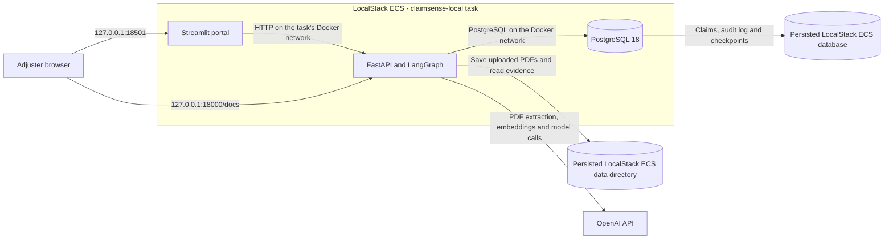
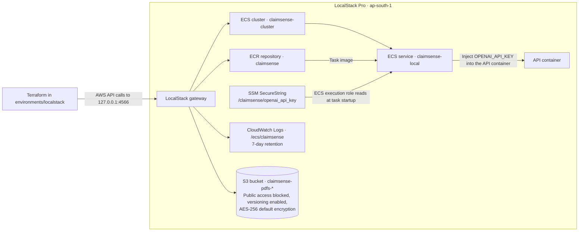
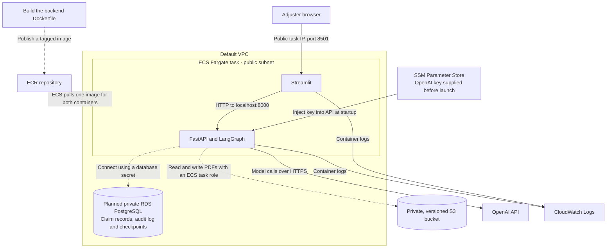

# Claim-Sense infrastructure

LocalStack Pro runs Claim-Sense in the `claimsense-local` ECS service. Docker Compose provides a separate development environment. Each environment has its own PostgreSQL database and data directory.

## 1. Where a LocalStack ECS claim goes

When a review pauses, PostgreSQL stores the claim's thread ID and its LangGraph checkpoint. The local task stores PostgreSQL files and uploads under `~/.cache/claimsense-ecs/` so the data is available to replacement tasks. The API stores PDFs in its mounted data directory. The S3 bucket is ready for the planned storage integration. [Claim processing and review flow](Design.md)

- Streamlit portal [http://127.0.0.1:18501/](http://127.0.0.1:18501/)
- FastAPI docs [http://127.0.0.1:18000/docs](http://127.0.0.1:18000/docs)

## 2. What Terraform provisions in LocalStack

Terraform provisions the foundation first. Publishing the image and applying the local configuration again adds the service, task definition and execution permissions. Run `make local-check` in the Terraform repository to check the running service and its HTTP endpoints. [Terraform repository](https://github.com/MP-30/Claim-Sense-Terraform)

### OpenAI configuration and claim retries

Store the OpenAI key in LocalStack Parameter Store as a `SecureString`. The local Terraform variables file, `environments/localstack/local-model.auto.tfvars.json`, contains the parameter name and model setting. ECS reads the key during task startup and sets `OPENAI_API_KEY` for FastAPI. The verified local deployment uses `gpt-5.4-nano`. [LocalStack setup](https://github.com/MP-30/Claim-Sense-Terraform)

The portal and API health endpoint can respond before OpenAI credentials are configured. If a submission records `OpenAIError: Missing credentials`, check the parameter, apply the ECS configuration so the replacement task receives the key, and resubmit the claim. On 24 November 2026, rerunning synthetic claim `CLM-1007` through the portal's API endpoint changed its status from `FAILED` to `APPROVED` with a payout of ₹12,100.

## 3. How the AWS demo is designed to run

Solid arrows show runtime connections described by the root Terraform configuration or backend code. Dashed arrows show work still needed for deployment. This is the target topology for M6.

The root Terraform configuration defines one Fargate task with two containers sharing a network interface. Its security group allows ports 8501 and 8000 from `allowed_cidr`. ECS uses the **execution role** to pull the image, deliver logs and read the OpenAI key from `/claimsense/openai_api_key`. The proposed **task role** gives the running API access to claim objects in S3.

**Remaining work for the demo**

1. Provision PostgreSQL, allow database traffic from the task security group, and supply the API's database connection secret. Keep secret values outside Terraform state.
2. Update intake to store uploaded PDFs in S3 and retain their object keys with the claim. Provision the synthetic demo inputs separately. The image build excludes uploads and sample claim directories. [Docker build exclusions](.dockerignore)
3. Publish the tagged image, supply the OpenAI parameter, then start the service. Submit a synthetic claim that needs review, replace the task, and approve the same claim. Verify its decision, audit history and PDFs survive replacement before demonstrating teardown. [M6 acceptance criteria](roadmap.md#m6--demonstrate-deployment-and-teardown)
