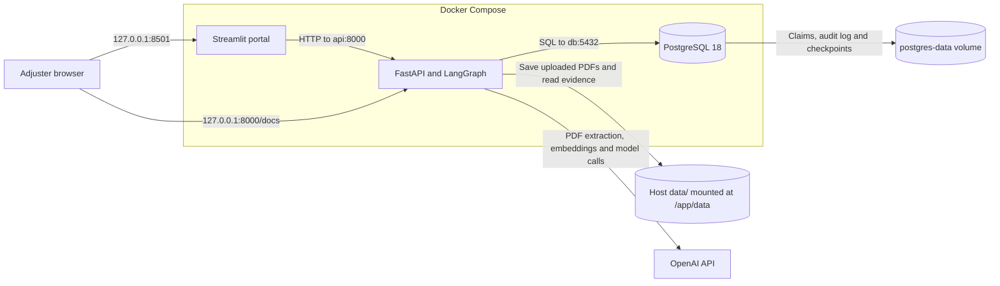
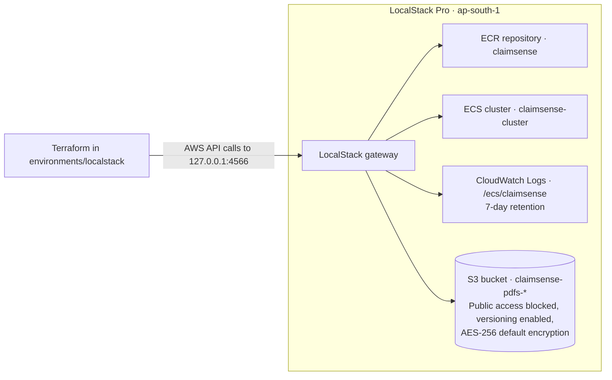
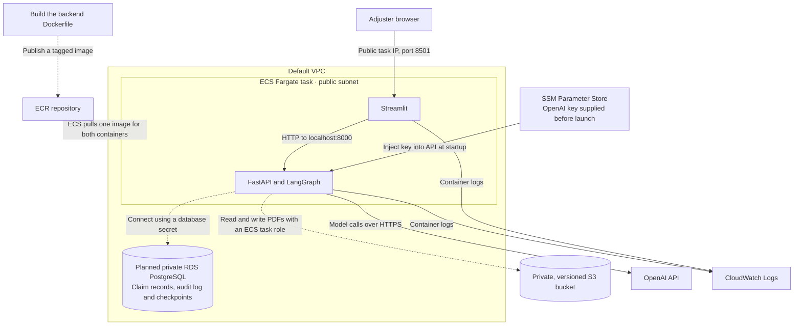

# Claim-Sense infrastructure

Docker Compose runs the claims application. LocalStack Pro hosts the first stage of its AWS infrastructure on the same machine. As of 24 November 2026, a claim submitted through the local portal uses Compose PostgreSQL and the mounted data directory. The ECS cluster in LocalStack is empty.

## 1. Where a local claim goes

When a review pauses, PostgreSQL stores both the claim's thread ID and its LangGraph checkpoint. Uploaded PDFs live under `data/uploads/<claim_id>/`. Replacing the API container preserves both the pending review and its files as long as the database volume and host directory remain available. [Compose configuration](docker-compose.yml) · [Claim processing and review flow](Design.md)

## 2. What Terraform provisions in LocalStack

Terraform manages seven resources here. S3 accounts for four of them because Terraform manages the bucket, public access block, versioning and encryption individually. To inspect the emulator, run `make local-check` from the Terraform repository. To find the generated bucket name and ECR URL, run `terraform -chdir=environments/localstack output` there. [Terraform repository](https://github.com/MP-30/Claim-Sense-Terraform)

## 3. How the AWS demo is designed to run

Solid arrows show runtime connections described by the root Terraform configuration or backend code. Dashed arrows show work still needed for deployment. This is the target topology for M6.

The root Terraform configuration defines one Fargate task with two containers sharing a network interface. Its security group allows ports 8501 and 8000 from `allowed_cidr`. ECS uses the **execution role** to pull the image, deliver logs and read the OpenAI key from `/claimsense/openai_api_key`. The proposed **task role** gives the running API access to claim objects in S3.

**Remaining work for the demo**

1. Provision PostgreSQL, allow database traffic from the task security group, and supply the API's database connection secret. Keep secret values outside Terraform state.
2. Update intake to store uploaded PDFs in S3 and retain their object keys with the claim. Provision the synthetic demo inputs separately. The image build excludes uploads and sample claim directories. [Docker build exclusions](.dockerignore)
3. Publish the tagged image, supply the OpenAI parameter, then start the service. Submit a synthetic claim that needs review, replace the task, and approve the same claim. Verify its decision, audit history and PDFs survive replacement before demonstrating teardown. [M6 acceptance criteria](roadmap.md#m6--demonstrate-deployment-and-teardown)
